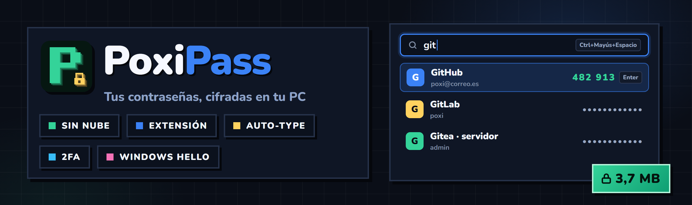

 

**🇪🇸 Español** · [🇬🇧 English](#-english)

### Tus contraseñas, cifradas en tu PC. Sin nubes, sin cuentas, sin rollos.

---

## 🎯 Qué es

**PoxiPass** es un gestor y generador de contraseñas para Windows. Todo vive en **un archivo cifrado en tu PC**
(tu *llavero*). No hay servidor, no hay cuenta que te puedan hackear y no se manda nada a ninguna parte.
Si quieres tenerlo en varios PCs, mete el archivo en Drive u OneDrive y listo.

## ✨ Qué hace

- ⚡ **Acceso rápido**: **Ctrl+Mayús+Espacio** desde cualquier sitio para buscar y escribir o copiar sin abrir PoxiPass.
- ⚡ **Alta rápida**: escribe la web o el nombre y el usuario; la contraseña ya viene generada.
- 🎲 **Generador** de contraseñas y de frases fáciles de recordar, con medidor de fortaleza.
- 🧩 **Extensión para Chrome, Edge, Brave, Opera y Vivaldi**: rellena y guarda contraseñas (también 2FA, tarjetas e identidades) solo en la web de verdad. La contraseña maestra no sale de la app.
- ⌨️ **Auto-type**: pulsa **Ctrl+Alt+A** en cualquier login y PoxiPass escribe usuario y contraseña (en los navegadores, elige la cuenta por el dominio real de la web) y te deja copiado el código 2FA.
- 🔢 **Códigos 2FA** dentro de cada entrada (pega la clave o una captura del QR).
- 🩺 **Salud del llavero**: débiles, repetidas, antiguas y **filtradas** (Have I Been Pwned).
- 👆 **Windows Hello**: desbloquea con huella, cara o PIN.
- 🆘 **Kit de emergencia**: unas palabras de la **Lista Poxi** te devuelven el acceso si olvidas la contraseña maestra.
- 💳 **Tarjetas, notas seguras, identidades, Wi-Fi (con QR para conectarse), claves SSH, licencias, cuentas bancarias y documentos**, con adjuntos cifrados, historial de cambios y avisos de caducidad.
- 🔒 **Entradas sensibles**: piden Windows Hello para verlas, copiarlas o escribirlas.
- ☁️ **A prueba de Drive/OneDrive**: si el llavero cambia en otro PC, se fusiona entrada a entrada.
- 🗄️ **Archivo, duplicados, selección múltiple y arrastrar a carpetas.**
- 📥 **Importa** desde Chrome, Edge, Firefox, Bitwarden, KeePass y KeePassXC.
- 💾 **Copias automáticas** cifradas (también en una carpeta extra, como un USB), restaurables desde la app aunque hayas borrado el archivo.
- 🎨 Temas oscuro y claro, 6 colores, español e inglés. Se actualiza solo.

## 🔐 Seguridad

| | |
|---|---|
| **Contraseña maestra** | Argon2id (64 MiB, 3 pasadas): probar contraseñas a lo bruto es carísimo |
| **Datos** | XChaCha20-Poly1305. La cabecera del archivo también está autenticada: si alguien toca un solo byte, no abre |
| **En memoria** | Con el llavero abierto, cada contraseña sigue **sellada** con una clave de sesión protegida por Windows (`CryptProtectMemory`). Solo se descifra al verla, copiarla o escribirla, y se borra al momento |
| **Interfaz** | Las contraseñas no viajan a la interfaz salvo que pidas verlas. Copiar y auto-type van directos desde Rust |
| **Portapapeles** | Se borra solo (20 s por defecto) y nunca entra en el historial de Win+V ni en la nube de Windows |
| **Filtraciones** | Have I Been Pwned con *k-anonymity*: solo salen del PC 5 caracteres del hash de cada contraseña |
| **Bloqueo** | Por inactividad, al bloquear Windows (Win+L), al suspender o con Ctrl+L |
| **Kit de emergencia** | 256 bits de azar como palabras (con checksum). Es otra llave del mismo llavero: cambiar la contraseña maestra no lo invalida |
| **Windows Hello** | La llave vive en el chip TPM de tu PC y nunca en el archivo. Cada 14 días se vuelve a pedir la contraseña maestra |

> ⚠️ Nadie puede recuperar tu contraseña maestra: ni nosotros ni nadie. Guarda bien tu kit de emergencia.

## 📥 Descarga

Busca la última versión en **[Releases](../../releases/latest)**:

| Archivo | Para qué |
|---|---|
| `PoxiPass-Setup-x.y.z.exe` | **Instalador**. Se actualiza solo |
| `PoxiPass-Portable-x.y.z.exe` | **Portable**. Se ejecuta tal cual, no instala nada |
| `PoxiPass-Extension-x.y.z.zip` | **Extensión** para Chrome, Edge, Brave, Opera y Vivaldi |

Requiere Windows 10 u 11 (64 bits) y WebView2, que ya viene de serie.

> 🛡️ Si Windows dice «Windows protegió tu PC», pulsa **Más información → Ejecutar de todas formas**. Sale con
> todos los programas nuevos sin firma de pago; el código está aquí mismo.

### 🧩 Instalar la extensión

Mientras llega a las tiendas, se instala desde el zip:

1. Descomprime `PoxiPass-Extension-x.y.z.zip` en una carpeta que no vayas a borrar.
2. Abre `chrome://extensions` (o `edge://extensions`) y activa el **modo de desarrollador**.
3. Pulsa **«Cargar descomprimida»** y elige esa carpeta.
4. Con PoxiPass abierto, pulsa el icono de la extensión → **«Conectar»** y acepta en la app (el código tiene que coincidir).

## ⌨️ Atajos

| Atajo | Qué hace |
|---|---|
| `Ctrl+Mayús+Espacio` | Acceso rápido (desde cualquier app) |
| `Ctrl+Alt+A` | Auto-type en la ventana activa (en cualquier app) |
| `Ctrl+K` / `Ctrl+F` | Buscar |
| `Ctrl+N` | Nueva entrada |
| `Ctrl+E` | Editar |
| `Enter` / `Ctrl+C` / `Ctrl+B` | Copiar contraseña / contraseña / usuario |
| `Ctrl+A`, `Ctrl+clic`, `Mayús+clic` | Elegir varias entradas |
| `Ctrl+L` | Bloquear |
| `↑` `↓` | Moverte por la lista |

## 🛠️ Desarrollo

Tauri 2 + Rust (todo lo sensible) y React + TypeScript (la interfaz).

- `start.bat`: modo desarrollo.
- `deploy.bat`: instalador firmado + portable + `latest.json` en `deploy-hosting\`.
- `cd src-tauri && cargo test`: tests del núcleo.
- `node extension/build.mjs`: compila la extensión en `extension/dist` (se carga como «descomprimida»); con `--store`, además, el zip de la release (con `key`, para cargarla descomprimida) y el de las tiendas (sin `key`).

## 📄 Licencia

[PolyForm Noncommercial 1.0.0](LICENSE): úsalo, estúdialo y modifícalo gratis para uso no comercial.

---

## 🇬🇧 English

**PoxiPass** is a password manager and generator for Windows. Everything lives in **one encrypted file on your PC**
(your *keychain*). No server, no account to hack, nothing sent anywhere. To use it on several PCs, put the file in
Drive or OneDrive.

### ✨ Features

- ⚡ **Quick access**: **Ctrl+Shift+Space** anywhere to search and type or copy without opening PoxiPass.
- ⚡ **Quick add**: type the website or a name and the username; the password is already generated.
- 🎲 **Generator** for passwords and easy-to-remember passphrases, with a strength meter.
- 🧩 **Extension for Chrome, Edge, Brave, Opera and Vivaldi**: fills in and saves passwords (2FA, cards and identities too) only on the real website. Your master password never leaves the app.
- ⌨️ **Auto-type**: press **Ctrl+Alt+A** on any login page and PoxiPass types your username and password.
- 🔢 **2FA codes** inside each entry (paste the key or a screenshot of the QR code).
- 🩺 **Keychain health**: weak, reused, old and **breached** passwords (Have I Been Pwned).
- 👆 **Windows Hello**: unlock with your fingerprint, face or PIN.
- 🆘 **Emergency kit**: a few words from the **Poxi List** get you back in if you forget your master password.
- 💳 **Cards, secure notes, identities, Wi-Fi (with a QR code to connect), SSH keys, licenses, bank accounts and documents**, with encrypted attachments, change history and expiry alerts.
- 🔒 **Sensitive entries**: ask for Windows Hello to view, copy or type them.
- ☁️ **Drive/OneDrive-proof**: if the keychain changes on another PC, it's merged entry by entry.
- 🗄️ **Archive, duplicates, multi-select and drag to folders.**
- 📥 **Import** from Chrome, Edge, Firefox, Bitwarden, KeePass and KeePassXC.
- 💾 **Automatic encrypted backups** (also to an extra folder such as a USB drive), restorable from the app even if you deleted the file.
- 🎨 Dark and light themes, 6 colors, Spanish and English. Updates itself.

### 🔐 Security

- **Master password**: Argon2id (64 MiB, 3 passes). **Data**: XChaCha20-Poly1305, with an authenticated header.
- **In memory**, every password stays **sealed** with a Windows-protected session key and is only decrypted to show,
  copy or type it. Passwords never reach the UI unless you ask to see them.
- **Clipboard** clears itself and never lands in Win+V history or the Windows cloud clipboard.
- **Breach check** via Have I Been Pwned with *k-anonymity*: only 5 characters of each password's hash leave your PC.
- **Locks** on inactivity, Windows lock (Win+L), sleep or Ctrl+L.
- **Windows Hello** keys live in your PC's TPM, never in the file. The master password is asked again every 14 days.

> ⚠️ Nobody can recover your master password. Keep your emergency kit safe.

### 📥 Download

Get the latest version from **[Releases](../../releases/latest)**: `PoxiPass-Setup-x.y.z.exe` (installer, updates
itself) or `PoxiPass-Portable-x.y.z.exe` (portable). Windows 10 or 11, 64-bit.

**Browser extension** (until it's in the stores): unzip `PoxiPass-Extension-x.y.z.zip` into a folder you'll keep, open
`chrome://extensions` (or `edge://extensions`), turn on **developer mode**, click **"Load unpacked"** and pick that
folder. With PoxiPass open, click the extension icon → **"Connect"** and accept in the app (the codes must match).

### 📄 License

[PolyForm Noncommercial 1.0.0](LICENSE).
